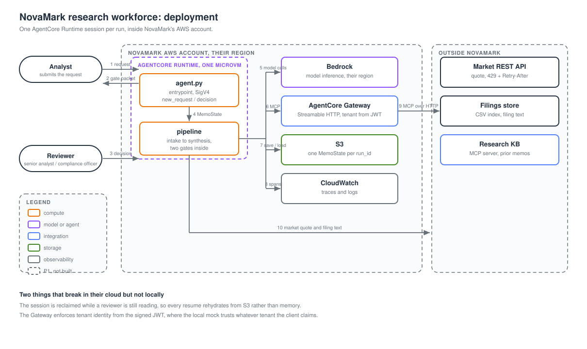

# NovaMark: Analyst Factory 

## Overview

NovaMark Capital Partners is an asset manager whose analysts write equity research memos by hand from market data, filings and the firm's prior research, and whose compliance team then reviews each memo by hand. The requirements, in a nutshell: produce an auditable memo, where every AI-extracted figure carries a citation and a confidence; hold a senior analyst's review for weak figures and a compliance approval before anything is published; and cut memo time from 4 to 6 hours to under 45 minutes.

This project is an agentic proof of concept of that workflow: a state machine built with [Strands Agents](https://strandsagents.com) that runs on Amazon Bedrock AgentCore Runtime, or locally, against mock market-data and research systems.

**Further reading:**

- [Requirements](docs/requirements.md): what the system must do, and the process flow
- [Architecture](docs/architecture.md): the state machine, the runtime, security, and what is not built
- [Decisions](docs/decisions.md): the choices made and what each rejected
- [Code reviews](docs/code-reviews.md): review findings and planned refactors
- [Deployment](docs/deployment.md): where the run executes, and what breaks in NovaMark's account
- [CFO brief](docs/cfo-brief.md): the five figures, and what this prototype did not measure



## Run the demo

The demo runs against a deployed AgentCore Runtime, so you deploy first. Follow the steps in order.

**You need:** Python 3.12, [uv](https://docs.astral.sh/uv/), Node.js (for `npx aws-cdk`), and an AWS CLI profile for the account and Region you will deploy to (default `us-west-2`). The account needs Amazon Bedrock access to the inference profile `us.anthropic.claude-sonnet-4-6`.

**1. Install and test.** The tests run entirely on your machine: no AWS credentials, no model calls, no cost. A guard in `tests/conftest.py` fails any test that tries to reach the network or Amazon Bedrock.

```sh
uv sync
uv run pytest
```

**2. Deploy.** From the repo root. CDK builds a linux/arm64 Python 3.12 code zip (no container) and creates the state bucket, the runtime role and the AgentCore Runtime.

```sh
npx aws-cdk bootstrap     # once per account and Region
npx aws-cdk deploy
```

**3. Export the runtime ARN.** The deploy prints it as the stack output `RuntimeArn`. It must be the runtime's ARN, which starts with `arn:aws:bedrock-agentcore`. The stack's own ARN (`arn:aws:cloudformation:...`) is rejected with `Invalid service name in ARN`.

```sh
export NOVAMARK_RUNTIME_ARN=arn:aws:bedrock-agentcore:<region>:<account>:runtime/<name>-<id>
```

**4. Run the deployed tests.** The three tests in `tests/test_deployed.py` call the runtime with that ARN. They make real model calls, billed to your account, so `uv run pytest` never runs them. They run only when you name the file, as below, with the ARN set.

```sh
uv run pytest tests/test_deployed.py -v
```

**5. Run the demo.** It makes real model calls, billed to your account.

```sh
uv run python src/demo.py
```

The demo stops at each review and asks you to approve or reject. It asks for your name and a comment. The clean filing asks only the compliance officer. Pass `--high-risk` to run the filing that also asks the senior analyst. Pass `--auto-approve` to approve each review with no one at the keyboard.

```sh
uv run python src/demo.py --high-risk
uv run python src/demo.py --auto-approve
uv run python src/demo.py --high-risk --auto-approve
```

**What you see.** One memo. Each state is a colored box. It fills in when the runtime answers, and the current review is highlighted. The run continues only after that review is decided.

- **AAPL, the clean filing.** This is the default. The stated figures are revenue, gross margin, and operating income. A metric the filing never mentions is left out. Supplier concentration is not scored high. Every confidence is at or above 0.75 and the risk is not high, so the run skips `senior_review`, stops only at `compliance_review`, and then prints `published`.
- **NVDA, the high-risk filing.** Pass `--high-risk`. The Gaming figure has no scale unit, so its confidence is capped under 0.75, and the filing states customer concentration and export controls, so the risk is high. The run stops at `senior_review`, then `compliance_review`, then prints `published`.

At a review, the box below the track lists who must decide, the flagged figures, the risk, any data gaps, and every extracted figure with its confidence and the sentence it came from. After the compliance approval the memo appears in a green box, with the number of recorded decisions. The full history of each run is saved in the state bucket as one snapshot per pause and one at the end.

**Remove it** when you are done:

```sh
npx aws-cdk destroy
```

### How the demo is authenticated

The runtime has no password or API key. The demo signs each request with AWS Signature Version 4 (SigV4), using your AWS credentials from your environment or CLI profile. AgentCore checks the signature with IAM, and the request runs only if your identity is allowed to invoke this runtime. An unsigned request, or one from an identity without permission, is rejected with a 403 before any code runs. Your secret key never leaves your machine.

The demo reads the Region from `AWS_REGION` (default `us-west-2`), which must match the stack's Region. The review gates are not separate logins: the demo sends the reviewer's role and name in the request body, and the runtime does not yet check them against the signing identity. See [Security](docs/architecture.md#security).

### Run the agent locally

You can also run the agent on your machine. Nothing needs to be deployed, but each run calls Amazon Bedrock with your credentials and is billed to your account.

```sh
uv run python -m novamark.agent    # http://127.0.0.1:8080
```

A request starts a run. It stops at a review gate and returns the packet with a `run_id`:

```sh
uv run http POST localhost:8080/invocations \
  type=new_request \
  request:='{"ticker":"NVDA","asset_class":"equity","analysis_type":"memo"}'
```

A decision resumes that run:

```sh
uv run http POST localhost:8080/invocations \
  type=decision run_id="<id>" roles:='["senior_analyst"]' \
  decision:='{"gate":"senior_review","action":"approve","reviewer":"you","comment":"ok"}'
```

## Case data and mocks

The deployed memo uses the mock market and prior-research data below, which run inside the agent. Set `MARKET_API_URL` to use a real market service.

`src/data` holds three filings, indexed by `filings_metadata.csv`: `AAPL_10K_excerpt.txt` (the tidiest), `NVDA_10K_excerpt.txt` (a partly garbled table), and `MSFT_earnings_transcript.txt` (unstructured, with hedged language). Units are mixed, some figures are stated in one place and only derivable in another, and at least one claim is left unquantified.

`src/mocks` holds the two systems the firm already runs:

- **Market data API** (`mock_market_data_api.py`): `GET /api/v1/market/quote?ticker=&fields=` with `Authorization: Bearer MOCK_API_KEY_12345`. Tickers are AAPL, MSFT, GOOGL, TSM and NVDA. Every fifth authorized call returns 429 with `Retry-After`. To serve it on its own, run `uv run uvicorn mocks.mock_market_data_api:app --port 8000` from `src`.
- **Research knowledge base** (`mock_mcp_research_kb_server.py`): a Model Context Protocol (MCP) server over stdio with the tool `search_research_kb(query, ticker, max_results)` and the resource `research://memos/{ticker}/history`. It reads the tenant from `params._meta.tenant_id` and serves only `novamark`. The client supplies that value, so a real deployment must take the tenant from a verified identity.

`tests/smoke_test.py` checks that the market mock answers, including the 429. It needs the mock running on `:8000`.
