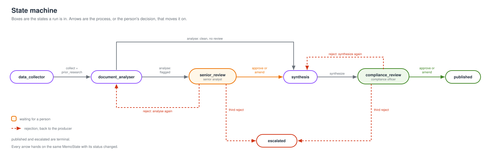
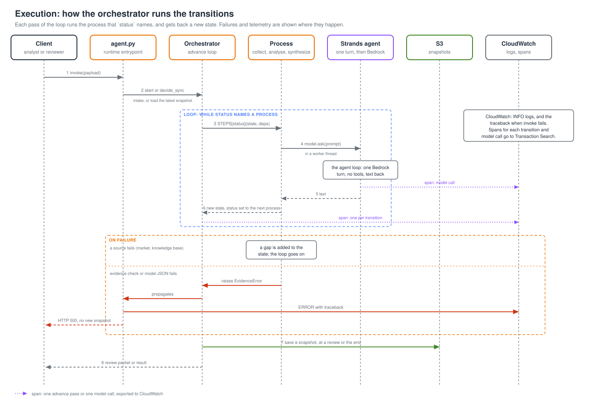
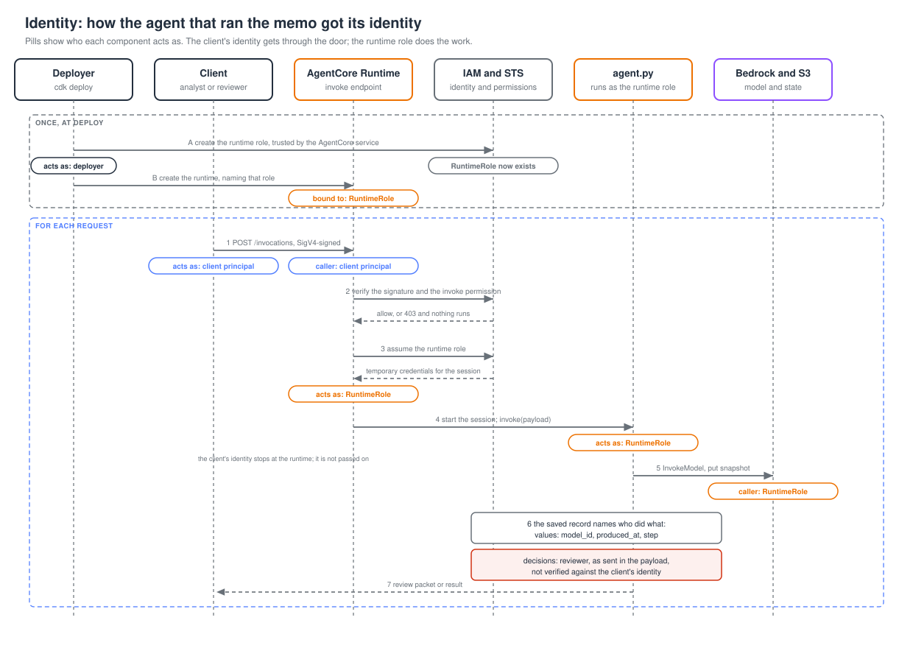

# Architecture: Research Workforce

The harness takes one request (a ticker, an asset class and an analysis type) and produces an investment memo that can be audited, with a senior analyst and a compliance officer approving it along the way. It is a linear pipeline over a single typed state, and the model is limited to three prompts. The table below maps each requirement to the component that meets it, and the rest of the page describes how those components fit together. The alternatives we rejected are in [decisions.md](decisions.md), and open issues are in [code-reviews.md](code-reviews.md).

| Requirement | Component |
| --- | --- |
| One clean run and one flagged run, end to end | [Orchestrator](../src/novamark/orchestrator.py) |
| Market data and filings with freshness; back off on 429 | [Data collector](../src/novamark/process/data_collector.py) |
| Every metric has a citation and a confidence; risk scored against configurable thresholds | [Document analyser](../src/novamark/process/document_analyser.py), [risk assessor](../src/novamark/process/risk_assessor.py) |
| Prior firm research; the run continues if the server fails | [Knowledge base](../src/novamark/knowledge_base.py) (MCP) |
| No value passes without a citation and a confidence | [Evidence check](../src/novamark/process/evidence_check.py) |
| Analyst approval before the memo, compliance approval before publish | [Gates](../src/novamark/process/gates.py) |
| Complete audit of AI output | [Snapshot store](../src/novamark/state.py) |
| Customer data stays in their cloud | [Bedrock and S3 in one account](../src/deploy.py) |

Four properties shape the design:

1. **Asynchronous pipeline.** Independent sources are fetched at the same time.
2. **State machine.** Every step is a named `status`, and a run resumes from stored state process.
3. **Immutable snapshots.** Each one is written once and never edited.
4. **Idempotent decisions.** A retried decision is applied only once.

[Strands Agents](https://strandsagents.com/) is used only for reasoning. It runs a single `Agent` with a fixed system prompt and no tools ([model.py](../src/novamark/model.py)), and that agent does three jobs: it extracts metrics, lists the risks stated in the text, and writes the memo. Everything else, including fetching data, checking evidence and moving between steps, is ordinary Python. This keeps the path that produces evidence the same from run to run, and it means there is no tool routing to reason about.

## The state machine

A run is one `MemoState` dict ([state.py](../src/novamark/state.py)). Its `status`, one of the [`Status`](../src/novamark/state.py) values, is the state the run is in, and it also names the process that runs next. The [orchestrator](../src/novamark/orchestrator.py) is a loop on `status`, so nothing else decides the order of steps.



**State Schema**

A run is one entity, its metrics are attribute-value entries, and every save is a snapshot in S3.

```python
class MemoState(TypedDict):
    run_id: str                  # the entity, and the store key
    request: Request             # ticker, asset_class, analysis_type
    status: Status               # the process that runs next
    revision: int                # rejections so far, capped at three
    sources: dict[str, str]      # source id -> exact text, so a citation can be checked
    values: dict[str, dict]      # metric name -> value plus evidence
    risk: Risk | None            # level and reasons
    prior_memos: list[dict] | None   # None if the knowledge base failed
    gaps: list[Gap]              # what was unavailable, and why
    freshness: dict[str, str]    # when each source was last current
    decisions: list[Decision]    # append-only review log
    memo: str | None
    applied: list[str]           # decision ids already applied
```

`values` is what a reviewer reads. Each key is a metric the analyser looked for, and each entry is one finding: the figure, the sentence it came from, and how sure the model is. This is the entry for `segment_gaming`, read from a garbled table in the NVDA filing:

```python
"segment_gaming": {
    "value": 11900,
    "excerpt": "Gaming               $11,900",
    "confidence": 0.5,
    "reason": "figure has no scale unit; segment table",
    "model_id": "us.anthropic.claude-sonnet-4-6",
    "produced_at": "2026-10-29T09:14:48Z",
    "step": "document_analyser",
    "source_id": "DOC-NVDA-10K"}
```

| Field | Meaning |
| --- | --- |
| `value`, `excerpt`, `source_id` | the model's answer: the figure, the exact sentence it read it from, and which document that sentence is in. `value` is null when the filing does not state the metric |
| `confidence`, `reason` | the model's own 0 to 1 score and one-sentence why. The code lowers it to 0.5 when an amount has no scale word, or the value is null, and prefixes the reason |
| `model_id`, `produced_at`, `step` | added by the code, not the model: which model, when, and which process produced the entry |

The filing prints `Gaming $11,900` beside `$115.2 billion` with no scale word, so `11900` cannot be compared with the other figures. The code caps the confidence at 0.5, which is under the 0.75 floor, so the run stops at `senior_review` with this value flagged. A metric the filing does not state stays in `values` with a null value, so a reviewer sees it as missing and does not simply never see it. [`evidence_check`](../src/novamark/process/evidence_check.py) requires every value that is not null to have an excerpt and a confidence, and the excerpt must appear in `sources[source_id]`.

**Execution**



**Snapshot Log**

Each time a run stops, the orchestrator appends the whole state as the next numbered object under the run, and never rewrites one. This is the object written when a flagged run reaches `compliance_review` after the senior analyst approved (trimmed):

```
runs/run-1/001-compliance_review.json
{
  "run_id": "run-1",
  "request": {"ticker": "NVDA", "asset_class": "equity", "analysis_type": "memo"},
  "status": "compliance_review",
  "revision": 0,
  "sources": {"DOC-NVDA-10K": "...filing text..."},
  "values": {"segment_gaming": {"value": 11900, "confidence": 0.5, "...": "..."}},
  "risk": {"level": "medium", "reasons": ["..."]},
  "gaps": [{"source": "market", "reason": "..."}],
  "decisions": [{"gate": "senior_review", "action": "approve", "reviewer": "pri",
                 "comment": "ok", "decided_at": "2026-10-29T09:20:11Z", "id": ""}],
  "memo": "NVDA investment memo ...",
  "applied": []
}
```

`000-senior_review.json` is the state at the first review, before the decision: `decisions` is empty and `memo` is null. `load` returns the highest key, and listing the prefix replays the run in order, so an auditor who opens `001` sees exactly what the compliance officer saw.

## Runtime

One AgentCore Runtime session handles each run, in the customer's AWS account.

The session enters through `BedrockAgentCoreApp` and a single synchronous `invoke` ([agent.py](../src/novamark/agent.py)). That is the only place `asyncio.run` is called; everything below it is awaited. Model calls go to Bedrock under the customer's IAM. Bedrock Guardrails are not configured, so the evidence check is currently the only rule applied to model output.


State is kept in S3 because the session ends between the two reviews. Inference uses the `us.` Bedrock inference profile, which can route a request to another US region, so a customer that requires a single region would need a regional model id instead.

The market quote and the prior research are the case-study mocks, and both run inside the agent, locally and on AWS. The market mock is called in this process. The research knowledge base is `mock_mcp_research_kb_server.py`, started as a subprocess and spoken to over stdio. NovaMark's market system, research database, and ESG provider are not connected. A later path is HTTP behind AgentCore Gateway, with the tenant taken from the verified identity rather than from `params._meta.tenant_id`. That path is not built. Set `MARKET_API_URL` to call a market service over HTTP instead of the in-process mock.

## Scalability and reliability

**Scale.** Each run is one AgentCore Runtime session: a serverless microVM with its own CPU, memory and filesystem, started on demand and billed for active use. There is no fleet to size, and one run cannot read or slow another. The code keeps nothing in the session. A run's whole state is a snapshot in S3 and every process is a function from one state to the next, so any session can resume any run and more load means more sessions, not a bigger one. A review costs nothing while it waits, because the session is not held open.

**Reliability.** The snapshot is the unit of recovery. If a session dies, the run resumes from its latest snapshot, which is the last review, or starts again if it never reached one. A decision with an id is applied once, so a retried call cannot double-apply. A snapshot is written once, so a retry cannot overwrite history. A failed source becomes a gap and the run continues, and a value that fails the evidence check stops the run before a reviewer sees it. A 429 from the market API is retried after its `Retry-After`.

**Path to more scale.** These are the limits today and what removes each:

| Limit today | Next step |
| --- | --- |
| A throttled Bedrock call is not retried, so a burst of runs can stop with a 429 | retry with backoff in `model.ask`, raise the Bedrock quota, and put a queue in front of `start` to smooth bursts |
| Only reviews and the end are saved, so a crash mid-run repeats the work | save after each transition, at the cost of more snapshots |
| The snapshot sequence is an object count, so two concurrent writers collide and one fails | retry on conflict with a fresh count |
| `quote_once` blocks the event loop, so the two fetches run one after the other | switch to `httpx.AsyncClient` |
| No spans, so a slow or stuck run is invisible | emit spans per transition and per model call |

## Review decisions

[`gates.decide`](../src/novamark/process/gates.py) checks the reviewer's role first: a senior analyst clears `senior_review` and a compliance officer clears `compliance_review`.

| Action | Effect |
| --- | --- |
| approve | set the gate's next status |
| amend | overwrite the named values, stamped `human_amend` at confidence 1.0, then continue |
| reject | increment `revision` and return to the producing process, or escalate at three |

A decision that carries an id is applied once, so a retried call returns the state unchanged.

Two checks are not enforced yet: the decision's `gate` is never compared with the run's current `status`, and the requester is not recorded. See [Security](#security).

## Security



**Humans.** Every request is signed with SigV4, so only an IAM principal allowed to invoke the runtime can start a run or send a decision. The reviewer name and roles are plain fields in the request: `gates.decide` checks the role and the decision log stores the name, but neither is tied to the signing principal. Any permitted caller can therefore claim any role, and nothing stops a requester approving their own memo. The fix is to take both from the verified identity and record `requested_by` at intake.

**The agent.** The memo is produced by one IAM role that the runtime service assumes for the session. Every Bedrock and S3 call is signed as that role, and each extracted value records the `model_id` and time that produced it. The model has no credentials and no tools, and `evidence_check` tests every value it returns. The state bucket is KMS-encrypted, TLS-only and private, and each snapshot is written once. The role is broader than it should be: any Bedrock model, delete on the bucket, and no source account condition on its trust policy. These are tracked in [code-reviews.md](code-reviews.md).

## Failure

| Condition                                                               | Result                                                     |
| ----------------------------------------------------------------------- | ---------------------------------------------------------- |
| 429 from the market API∑                                                | retry with `Retry-After`, up to three attempts, then a gap |
| Other market error, missing filing, unreachable knowledge base          | gap, no retry; the run continues and the memo states it    |
| Value without a citation or confidence; excerpt not found in its source | run stops with `EvidenceError`                             |
| Malformed model JSON                                                    | run stops                                                  |
| Failed store write                                                      | run stops; no packet is returned                           |

A gap is passed to the review packet and stated in the memo. A stop returns an error and no packet, so a reviewer is never asked to approve a state that was not saved or a value that was invented.

Two limits apply. The analyser still runs when the quote and the prior memos are both missing, so a memo can be written from filing text alone, with only `senior_review` standing in the way. And a failed store write is not retried, because repeating a write whose outcome is unknown is how duplicate decisions get created.

## What is not here

This version has no review UI, multi-ticker runs, self-correction, ESG data, AgentCore Gateway or configured Bedrock Guardrail. None of them would change the state model.
