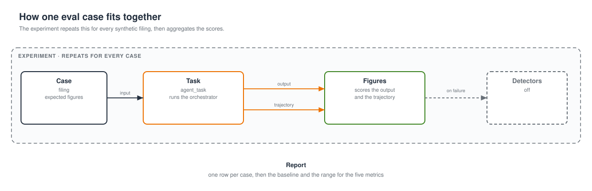

# Evals

The five success metrics in [requirements.md](requirements.md) are scored on labelled synthetic filings. The built-in run uses the Strands Evals SDK. A second option is Claude Code, pointed at the same cases and the same evaluator.

## How it fits together

Each case goes to the task, which returns the output and the trajectory; `Figures` scores them, detectors stay off, and the experiment repeats that for every filing into one report.



## Built-in Strands evals

```sh
uv run python src/demo.py --run-evals
uv run python src/demo.py --run-evals --runs 100
```

This does not call the AgentCore runtime. It runs the local agent on [src/data/synthetic/cases.json](../src/data/synthetic/cases.json). The model for those calls is Claude Haiku 4.5 (`us.anthropic.claude-haiku-4-5-20251001-v1:0`). Memos stay on Sonnet. One run per case unless `--runs` is set. The cap is 100.

Each case is one filing, the figures a person copied out of that filing, and an auditor estimate between 5 and 15 minutes. `--runs` repeats those cases in order. A run calls the orchestrator with that filing as the only source. The quote and the prior notes are empty stand-ins, so the score covers extraction, the risk pass, and the memo write up to the first review. The clock on that call is the agent time. The case's minutes are the auditor estimate.

The evaluator is `Figures` in [src/evals.py](../src/evals.py). It counts how many labelled figures came back with the same value. A run that returns every labelled figure scores 1. The consistency line is the mean of those scores. There is no judge model and no rubric.

The demo writes an experiment file, then runs:

```sh
strands-evals validate <file> --custom-evaluator evals:Figures
strands-evals run <file> --task evals:agent_task --custom-evaluator evals:Figures --fail-on threshold:0.9
```

`threshold:0.9` is the consistency target. The command exits 1 when the mean score is under 90%. The report still prints.

The report has two tables. The first is one row per run: the score, the agent seconds, the auditor estimate, and which figures missed. Under it are the run count, the consistency, the average agent time, and the average auditor estimate.

The second table is the five success metrics. Each row is where the firm is today, the target, the baseline from this run, and the range around that baseline.

| Metric | Baseline | Range |
| --- | --- | --- |
| Memo time | Mean agent time plus the mean auditor estimate | Fastest agent time plus 5 minutes, through slowest agent time plus 15 minutes |
| Gathering | About 0% of the analyst's time, because the pipe fetches the filing | 0–15%, allowing a reviewer who still opens the source |
| Compliance cycle | The mean of the 5–15 minute estimates | 5–15 minutes, which is the same day |
| Audit coverage | Complete for every run that returns a packet, because the pause writes a snapshot | From these runs to every memo the pipe publishes |
| Consistency | The mean figure score on this set | The lowest case score through the highest |

The baseline is this synthetic run. The range is the band it supports. Production evals keep this scorer and replace the stand-ins with the firm's filings and the recorded review times. That is how each number tightens toward the target.

## From the baseline to production

Each strategy below uses the same `Figures` check. The production run names the miss or the slow step, and the next change aims at that.

1. **Memo time.** Clock the deployed draft and the wait from the pause to the approval. Cut the slow model calls that clock names. The target is under 45 minutes once the officer's time is on the same clock.
2. **Gathering.** Connect the firm's market feed, filings, and research notes to the pipe that already fetches them here. Score how often a figure arrives with the analyst still opening a system. The target is under 20% of analyst time.
3. **Compliance cycle.** Read the approval time stored on the snapshot. The cycle is the wait from the ready draft to that approval. The target is the same day, which the 5–15 minute estimate already sits inside.
4. **Audit coverage.** Score every published snapshot for a citation, a confidence, and a named reviewer. The target is complete when every memo in the state bucket passes.
5. **Consistency.** Grow the labelled set from these three filings to a sample of real memos. Keep the key written by a person. Fail the run when the mean is under 90%, fix the figures the report names, and run again. Score the memo model, Sonnet, on that set so the model that publishes is the one being optimized. Haiku stays the fast loop for this synthetic set.

## Claude Code

The same cases and the same `Figures` evaluator can be driven from Claude Code with the Strands Eval SOP. Install the skill once:

```sh
claude plugin marketplace add strands-agents/agent-sop
claude plugin install agent-sops@agent-sop
```

Restart Claude Code, open this repo, and run `/eval`. Paste:

```text
Generate an evaluation plan for the NovaMark agent in this repo. The agent is src/novamark. The eval already exists. Use it. Do not invent a new one.

Read docs/requirements.md (Success Metrics), docs/evals.md, src/evals.py, and src/data/synthetic/cases.json.

Score only these five metrics. Keep today's number, the target, the baseline from this run, and the range around it.

1. Memo production time. Today 4–6 hours. Target under 45 minutes. Baseline is the mean agent seconds divided by 60, plus the mean auditor minutes. Range is the fastest agent time plus 5 minutes through the slowest agent time plus 15 minutes.
2. Analyst time gathering data. Today about 65%. Target under 20%. Baseline is about 0%, because the pipe fetches the filing. Range is 0–15%.
3. Compliance review cycle. Today 2–3 days. Target the same day. Baseline is the mean of the 5–15 minute auditor estimates. Range is 5–15 minutes.
4. Audit coverage of AI-assisted output. Today none. Target complete. Baseline is complete for every run that returns a packet. Range is these runs through every published memo.
5. Research consistency. Today 58%. Target above 90%. Baseline is the mean Figures score. Range is the lowest case score through the highest.

Consistency is labelled-figure agreement. The evaluator is Figures in src/evals.py. A case scores 1 only when every expected figure matches. There is no judge model, no rubric, and no OutputEvaluator.

Test data is the three cases in src/data/synthetic/cases.json. Do not generate new cases. One run per case unless --runs is set. Never more than 100.

Run the agent with the existing task evals:agent_task. That path calls Claude Haiku 4.5 and restores Sonnet when it finishes. Memos stay on us.anthropic.claude-sonnet-4-6. Do not change MODEL_ID.

Execute with the Strands Evals CLI:

strands-evals validate <experiment> --custom-evaluator evals:Figures
strands-evals run <experiment> --task evals:agent_task --custom-evaluator evals:Figures --fail-on threshold:0.9

Exit 1 means the mean score is under 90%. The report still prints.

The baseline and the range come from this synthetic set. Production evals keep this scorer, swap in a labelled sample of real memos, and read the recorded review time. That is how each number moves toward its target. Auditor minutes on these cases are the 5–15 estimate.

Do not deploy. Do not call the AgentCore runtime. Write the plan, then the report, from that run.
```

That session writes `eval/eval-plan.md` and `eval/eval-report.md`. It does not replace `uv run python src/demo.py --run-evals`.
