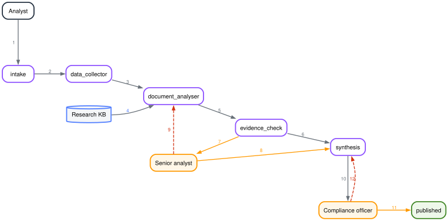

# Requirements: Governed Research Process

## Introduction

NovaMark Capital Partners manages $12 billion for sovereign and institutional clients (180 people; Dubai, London, Singapore). Fifteen research analysts assemble equity memos by hand from three separate systems: an internal research database, public filings, and an ESG provider. Compliance then reviews every memo by hand. Nothing produced with AI today would satisfy a regulator, and memo quality varies by analyst and by asset class.

CTO David Chen has asked for a design and a working prototype of a research-analyst workforce that ingests those sources, produces an auditable investment memo, holds a manager approval before anything is published, and connects to the systems the firm already runs. The prototype is the basis for their platform decision. Time box: 5–7 hours. If scope is cut, say what was cut and why.

## Success Metrics

These are the numbers NovaMark wants moved.

1. **Memo production time.** From 4–6 hours to under 45 minutes.
2. **Analyst time spent gathering data.** From about 65% to under 20%.
3. **Compliance review cycle.** From 2–3 days to the same day.
4. **Audit coverage of AI-assisted output.** From none today to complete.
5. **Research consistency.** From 58% to above 90%, across analysts and asset classes.

## Process Flow

Steps 2 and 3 run concurrently. A gap from either one travels to `synthesis` and is stated
in the memo rather than stopping the run. The two gates are the amber arrows: a person
decides, and the run is saved while it waits.

- **`intake`** validates the request and creates the typed state.
- **`data_collector`** fetches the market quote and the filings, with a retry on 429.
- **`document_analyser`** extracts every metric with a citation and a confidence, and scores risk against configurable thresholds.
- **`evidence_check`** fails closed on a missing or invented citation.
- **`synthesis`** writes the memo from approved values.

`document_analyser`, `risk_assessor`, and `synthesis` are the processes that call the model. The risk level itself is computed in code from the reasons the model lists.

The knowledge base is the firm's own system. Its memos are read concurrently with the market
and filings, then merged into the state. It is not one of our processes, and a failure there
becomes a gap that the run carries on with.

## Components

1. **Orchestrator.** Takes a ticker, asset class, and analysis type and passes typed state to each next step, and is responsible for one clean run and one low-confidence or high-risk run through to a memo.
2. **Data collector.** Takes a ticker and returns market data and filing citations with a freshness stamp, and is responsible for backing off when the market API rate-limits.
3. **Document analyser.** Takes filing text and returns a citation and confidence on every metric plus a separate risk result, and is responsible for scoring that risk against configurable thresholds.
4. **Knowledge base.** Takes a ticker and returns what the firm wrote six months ago, or a gap if the server fails, and is responsible for letting the run continue either way.
5. **Evidence and gates.** Takes each AI field and passes it on only with a citation and a confidence, and is responsible for an analyst decision before the memo is written and a compliance decision before it is published.

## Deliverables

1. **Working code.** Runs end to end on the provided data: orchestrator through the workers and the MCP tool, through both approval gates, to a final memo. One clean run, and at least one run on the low-confidence or high-risk path.
2. **A README.** Setup, environment, how to run it, and any keys required.
3. **An architecture description.** Agent roles and invocation patterns, gate positions and resume logic, how MCP maps onto a platform integration, what moves between steps and in what shape, and the technology choices with the reasoning behind them.
4. **A decision log, half a page.** Three decisions, the alternative rejected in each case, and why.
5. **A deployment answer, half a page.** NovaMark will not allow customer data to leave their own cloud environment. Where each component runs, where model inference physically happens, and two things that break in a customer-controlled environment which do not break locally.
6. **A one-page customer brief** for NovaMark's CFO, not an engineer. Where they are now and where they land, the numbers being moved, how a governed agentic workforce gets them there, and how the result would be proven. No feature list, no jargon.
7. **Discovery preparation.** Five questions for David Chen before building any of this, and three objections from NovaMark with an answer to each.

